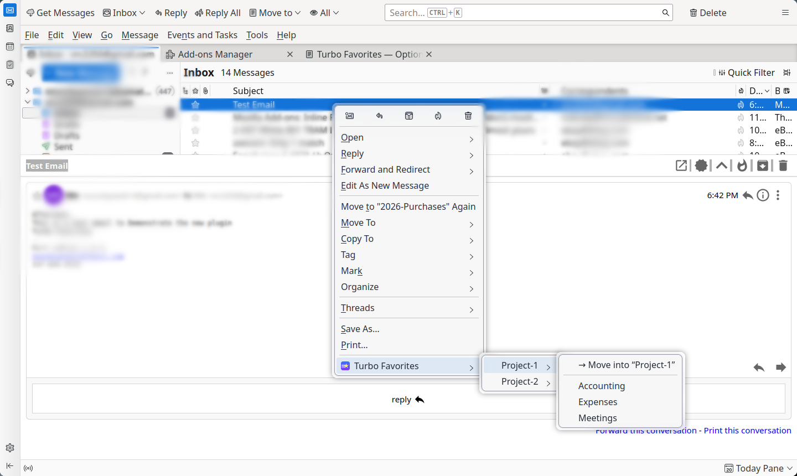
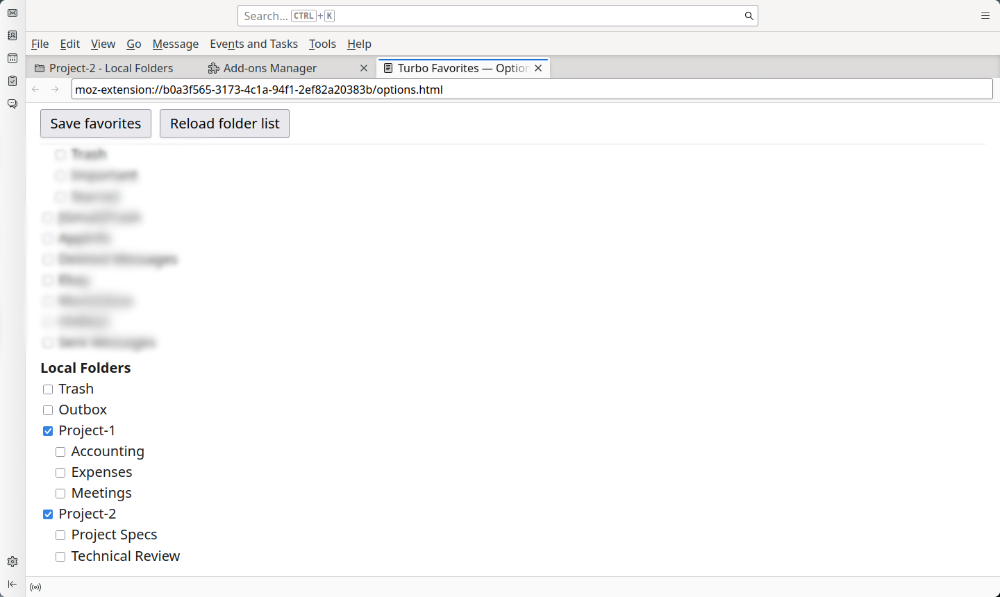
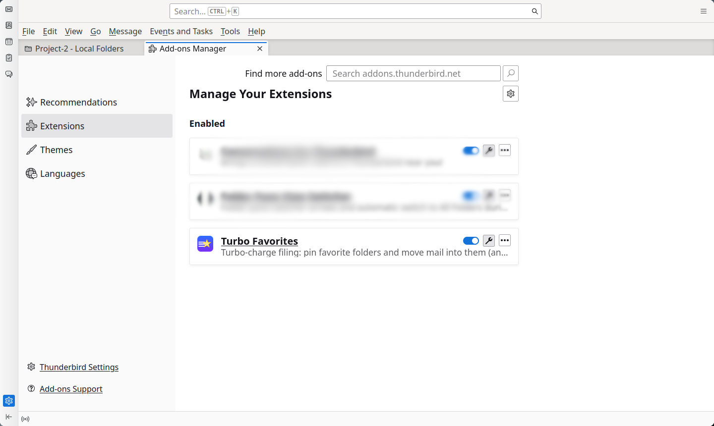

# Turbo Favorites (Thunderbird add-on)

Adds a **“Turbo Favorites ▸”** entry to the email right-click menu. You pin
favorite folders in the add-on's options page; each favorite — and *all* of its
subfolders, nested to any depth — then cascades as submenus so you can file
mail without drilling down from the account root every time.

Targets Thunderbird **128+** (built and tested against 153 ESR). Uses only
stable MailExtension APIs — no "experiment" code.

**Homepage / source:** https://github.com/vrc2250/TurboFavorites
**Downloads:** https://github.com/vrc2250/TurboFavorites/releases

## What it does

- Right-click a message → **Turbo Favorites** → hover a pinned folder → its
  subfolders fan out → click a target to move the selected message(s) there.
- A folder that has subfolders is itself a submenu; to drop mail directly into
  that parent folder use its **“→ Move into …”** entry at the top of the submenu.
- Works on multi-selection (moves all selected messages).

## Screenshots

**Right-click → Turbo Favorites: favorites and their subfolders cascade**



**Pick your favorite folders in the options page**



**Installed in the Add-ons Manager**



## Install (from a release)

1. Download the latest **`turbo-favorites.xpi`** from the
   [Releases page](https://github.com/vrc2250/TurboFavorites/releases).
2. In Thunderbird: **☰ menu → Add-ons and Themes → gear ⚙ → Install Add-on From File…**
3. Select the downloaded `.xpi` and confirm the permission prompt.

Installing an unsigned `.xpi` requires an **ESR / Daily** build with
`xpinstall.signatures.required` set to `false` in the Config Editor (until the
add-on is signed on addons.thunderbird.net).

## Install (temporary, for testing)

1. In Thunderbird: **☰ menu → Add-ons and Themes** (or Tools → Add-ons).
2. Click the **gear ⚙ icon → Debug Add-ons** (opens `about:debugging`).
3. **This Firefox/Thunderbird → Load Temporary Add-on…**
4. Select the **`manifest.json`** in this folder.

Temporary add-ons are removed when Thunderbird restarts — fine for trying it out.

## Configure favorites

1. On the add-ons page, open this add-on's **Options** (or it opens the first
   time you click *“Configure favorites…”* in the menu).
2. Tick the folders you want pinned, then **Save favorites**.
3. The right-click menu updates immediately.

## Build from source

Zip the add-on contents (not the folder itself) into an `.xpi`:

```sh
cd TurboFavorites
zip -r -FS ../turbo-favorites.xpi \
  manifest.json background.js options.html options.js LICENSE README.md icons/
```

Then install the resulting `.xpi` via the steps above. The icons are generated
by `make_icon.py` (requires Python + Pillow) — regenerate with
`python3 make_icon.py` if you change the artwork.

## Files

| File | Purpose |
|------|---------|
| `manifest.json` | Add-on metadata, permissions, entry points |
| `background.js` | Builds the context menu and performs the move |
| `options.html` / `options.js` | Favorites picker (folder tree w/ checkboxes) |
